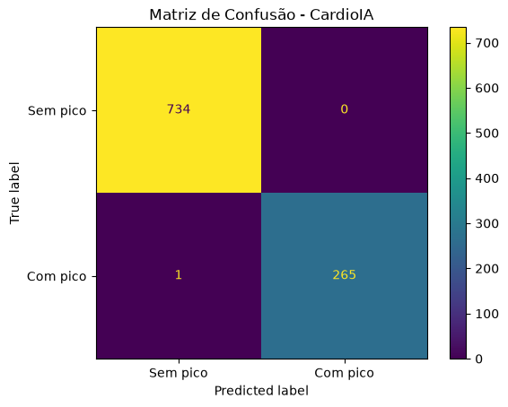

---
<p align="center">
  
</p>

<h1 align="center">CardioIA – Fase 6</h1>

## 👥 Integrantes

**Michelle Guedes Cavalari** — RM 564557  
**Gustavo Zanette Martins** — RM 564523

**Graduação em Inteligência Artificial – FIAP**
## 1. Modelo Preditivo

Foi criada uma base sintética com **5.000 registros** contendo as seguintes variáveis:

- idade média
- carga do sistema
- tempo de espera
- frequência cardíaca média
- SpO2 média
- pressão arterial sistólica
- temperatura
- densidade de eventos
- eventos nas últimas 24 horas
- disponibilidade de recursos

A variável-alvo utilizada foi:

`pico_risco`

O modelo utilizado foi o **RandomForestClassifier**, da biblioteca Scikit-learn.

Os dados foram separados em:

- **80% para treinamento**
- **20% para teste**

### Resultado do Modelo

O modelo obteve aproximadamente **99,9% de acurácia** no conjunto de teste.

Matriz de confusão:

```text
[[734   0]
 [  1 265]]
```

O alto desempenho deve ser interpretado considerando que este é um **dataset sintético** e que a variável-alvo foi construída a partir de regras determinísticas sobre as próprias variáveis de entrada.

O modelo treinado é armazenado em:

```text
models/modelo_risco.pkl
```

A matriz de confusão é armazenada em:

```text
resultados/matriz_confusao.png
```

### Matriz de Confusão

<p align="center">
  
</p>

---

## 2. Teste de Novo Caso

O modelo foi testado com o seguinte cenário:

```text
idade_media: 62
carga_sistema: 92
tempo_espera: 75
fc_media: 118
spo2_media: 89
pa_sistolica: 100
temperatura: 37.5
densidade_eventos: 7
eventos_24h: 5
disponibilidade_recursos: 25
```

Resultado obtido:

```text
Probabilidade de pico de risco: 100.00%
Classificação: ALTO RISCO
```

---

## 3. Sistema Multiagente

O sistema multiagente foi desenvolvido utilizando o **OpenAI Agents SDK**.

A arquitetura possui quatro agentes:

### 🤖 Agente Orquestrador

Responsável por iniciar e coordenar todo o fluxo entre os agentes.

### 📊 Agente Analista de Risco

Consulta o modelo de Machine Learning através de uma **tool** e obtém:

- probabilidade de pico de risco;
- previsão;
- classificação de risco.

### 📋 Agente Especialista em Protocolos

Consulta a base de conhecimento de protocolos e identifica quais regras são aplicáveis ao cenário analisado.

### 🧠 Agente Planejador de Resposta

Consolida as informações dos agentes anteriores e produz uma resposta estruturada contendo:

- probabilidade de risco;
- classificação;
- protocolos sugeridos;
- ações operacionais.

---

## 4. Fluxo Multiagente

```text
Novo caso
    ↓
Agente Orquestrador
    ↓ handoff
Agente Analista de Risco
    ↓ handoff
Agente Especialista em Protocolos
    ↓ handoff
Agente Planejador de Resposta
    ↓
Resposta estruturada
```

O projeto utiliza os seguintes recursos do sistema multiagente:

- **Tools**
- **Handoffs**
- **Message History**
- **Output Validation**

A validação da saída é realizada utilizando **Pydantic**, garantindo uma resposta final estruturada.

---

## 5. Resultado do Sistema Multiagente

Para o cenário utilizado no teste, o sistema retornou:

```text
Probabilidade: 100%
Classificação: ALTO RISCO
```

### Protocolos identificados

- Abrir unidades temporárias;
- Redistribuir insumos;
- Ativar plano de contingência;
- Ativar estado de emergência.

O Planejador de Resposta consolidou os protocolos em ações operacionais considerando os indicadores apresentados no cenário.

O histórico da execução registrou:

```text
Itens registrados no histórico: 12
```

Isso demonstra a manutenção do contexto durante o fluxo multiagente.

---

## 6. Estrutura do Projeto

```text
cardioia-fase6/
│
├── assets/
│   └── fiap-logo.png
│
├── data/
│   └── dataset_cardioia.csv
│
├── models/
│   └── modelo_risco.pkl
│
├── resultados/
│   └── matriz_confusao.png
│
├── agents_cardioia.py
├── gerar_dataset.py
├── main.py
├── protocolos.py
├── testar_modelo.py
├── testar_tools.py
├── tools.py
├── treinar_modelo.py
├── requirements.txt
├── .gitignore
└── README.md
```

> O arquivo `.env` é utilizado localmente para armazenar a chave da API e não é versionado no GitHub.

---

## 7. Como Executar

### Criar o ambiente virtual

```bash
python -m venv .venv
```

### Ativar o ambiente virtual no Windows

```powershell
.\.venv\Scripts\Activate.ps1
```

### Instalar as dependências

```bash
pip install -r requirements.txt
```

### Configurar a API

Crie um arquivo `.env` na raiz do projeto:

```text
OPENAI_API_KEY=sua_chave_aqui
```

> Nunca publique sua API Key no GitHub.

### Gerar o dataset

```bash
python gerar_dataset.py
```

### Treinar o modelo

```bash
python treinar_modelo.py
```

### Testar o modelo

```bash
python testar_modelo.py
```

### Testar as tools

```bash
python testar_tools.py
```

### Executar o sistema multiagente

```bash
python main.py
```

---

## 8. Tecnologias Utilizadas

- Python
- Pandas
- NumPy
- Scikit-learn
- Random Forest
- Joblib
- Matplotlib
- OpenAI Agents SDK
- Pydantic
- Python-dotenv
- Git
- GitHub

---

## 9. Segurança

O arquivo `.env` está incluído no `.gitignore` e **não é enviado ao GitHub**.

A chave da API da OpenAI não é armazenada diretamente no código-fonte.

---

## 10. Observação Acadêmica

Este projeto possui finalidade **exclusivamente acadêmica** e utiliza dados sintéticos.

O CardioIA apresentado nesta atividade **não realiza diagnóstico médico e não deve ser utilizado como substituto da avaliação ou decisão de profissionais de saúde**.

---

